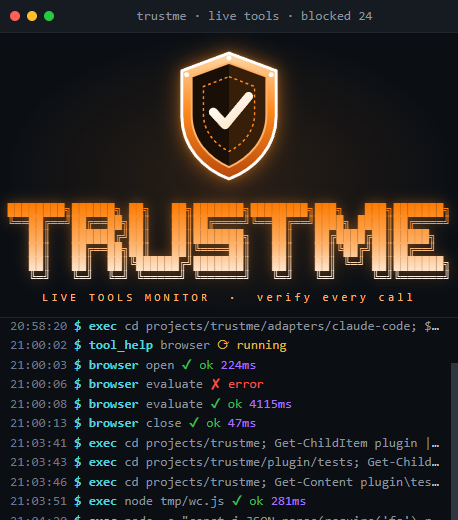

# TrustMe

Three layers that guard an AI agent's core files and actions. Honest summary of what each does:

| Layer | Part | Does | Does NOT do |
|---|---|---|---|
| 1 Detect | `file-guard` skill (signed baseline) | Finds changed core files; re-signing needs a one-time code sent to the owner | Prevent a change; it reports after |
| 2 Block | `file-guard-wall` plugin ("TrustMe wall") | Denies tool calls before they run: writes to protected files, dangerous commands, outbound actions after untrusted content was read | Stop a determined, creative attacker; regex rules can be evaded |
| 3 Alarm | `Chu-FileGuardWatch` task (hourly) | Runs layer 1 even when no agent is running; sends a Telegram alert once per new change | Block anything |

**Get it:** download `trustme-kit-v0.4.zip` from this repo. Layer 1 is the file-guard skill that lives in this repo (see `SKILL.md` and `docs/`); layers 2 and 3 and the live window are in the zip. Free, MIT.

## Live window

`powershell -File trustme.ps1 live` opens a small always-on-top window that shows every tool call the agent makes and how many the wall blocked. It runs on 127.0.0.1:7077 only and reads the plugin's own log; it sends nothing out.

Optional phone alert: copy `live/notify.example.ps1` to `live/notify.ps1` and set `TRUSTME_TG_TOKEN` and `TRUSTME_TG_CHAT`.

## Plugin rules
- **files**: no write/edit/move/delete on AGENTS.md, SOUL.md, TOOLS.md, HEARTBEAT.md, IDENTITY.md, the file-guard skill and its baseline. Quote/concat tricks are normalised.
- **danger**: remote code piped to a shell, encoded PowerShell, secret/credential stores, uploads/POST, raw transfer tools, scheduled-task/autorun persistence, destructive deletes, force push, weakening Defender.
- **trust**: after `web_fetch`, `web_search`, `browser`, peer reads, outbound shell/network calls, package installs, `message`, vault tools, `cron`, `gateway` are denied until the run ends (a new owner message starts a fresh run). This is the prompt-injection brake.

A denied agent is told to stop and ask the owner. Setting "Trust rule" is in plugin settings.

## Use
`powershell -File trustme.ps1 status` shows the three layers. `install` (re)creates the task.
The plugin (`$env:USERPROFILE\aicoworker\aicwgw\plugins\file-guard-wall`, copy in `plugin/`) is turned on only by the owner.

## Known limits
- Cannot read other tools' MCP or browser clicks; only tool names and params the plugin sees.
- Legit work that matches a rule (installing a package after reading docs) is denied once; the owner approves and asks again in a new message.
- The plugin cannot run the baseline check itself (no process permission by design); layer 3 does.

